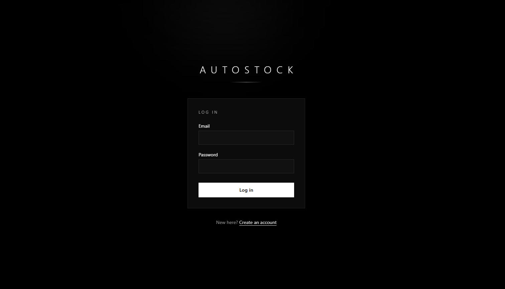
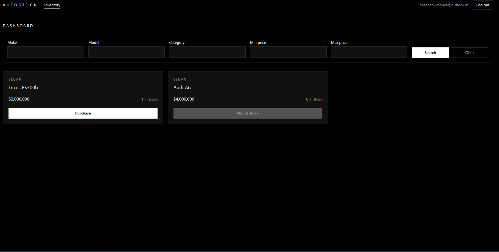
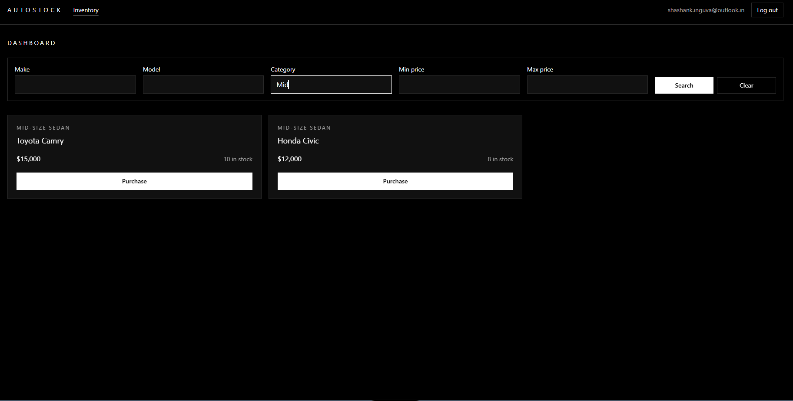
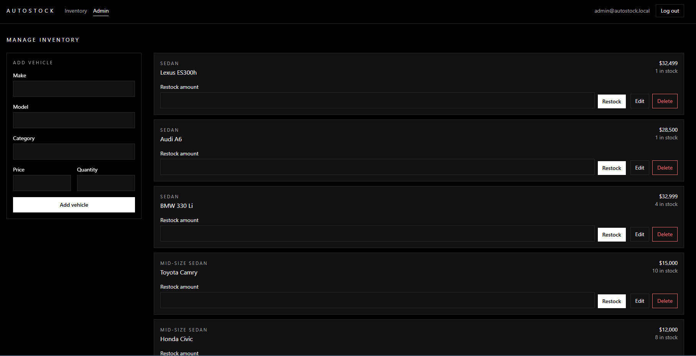

# AutoStock — Car Dealership Inventory System

## Overview

AutoStock is a full-stack inventory app for a car dealership. Signed-in users browse and search the stock and buy vehicles one unit at a time. Admins add, edit, delete and restock vehicles. The backend is a REST API (Express + Prisma on SQLite) with JWT auth; the frontend is a React single-page app.

It was built as a TDD kata: every behavior went in as a failing test, then the code to pass it, then a refactor, each as its own commit. `git log --oneline` shows the `test` → `feat` → `refactor` rhythm.

## Features

**Everyone (signed in)**
- Register and log in; the session survives a page reload and logout clears it.
- Vehicle dashboard with loading, empty and error (with retry) states.
- Search by make, model and category (partial, case-insensitive) and by min/max price; filters combine, blank filters are ignored, and Clear shows the whole list again.
- Purchase one unit. The button is disabled and reads "Out of stock" at quantity 0. The list refreshes after every purchase, and the result shows as a success or error toast.

**Admins only**
- An Admin link and `/admin` page that other users never see (the route redirects them to the dashboard).
- Add and edit vehicles with the same validation rules as the API.
- Delete with an inline confirmation step.
- Restock by a positive whole number of units.

**Under the hood**
- Layered backend: routes → controllers → services → repositories, with repositories injected so services are unit-tested with fakes.
- One error-handling middleware maps custom error classes to HTTP status codes; errors come back as `{ "error": "message" }`.
- Purchase is a single conditional `UPDATE`, so two buyers racing for the last unit can never push stock below 0.
- Passwords are hashed with bcrypt and never returned by the API.

## Tech Stack

| Area | Tools |
| --- | --- |
| Backend | Node.js, TypeScript, Express 5, Prisma 6 with SQLite, JSON Web Tokens (`jsonwebtoken`), bcrypt, zod |
| Backend tests | Jest 29, ts-jest, Supertest, against a separate `test.db` SQLite file |
| Frontend | React 19, TypeScript, Vite 8, React Router 7, Tailwind CSS 4 |
| Frontend tests | Vitest 5, React Testing Library, user-event, jsdom |
| CI | GitHub Actions |

## Local Setup

Prerequisites: Node.js 22.12 or newer (Vitest 5 needs it; developed on 22.16, CI uses the current LTS) and npm. No database server is needed: SQLite is a file inside `backend/prisma/`.

Run the backend and the frontend in two terminals.

### Backend

```bash
cd backend
cp .env.example .env      # Windows cmd: copy .env.example .env
npm install
npm run db:push           # prisma db push: creates prisma/dev.db from the schema and generates the client
npm run db:seed           # creates the demo admin; safe to run again ("already exists, nothing to do")
npm run dev               # tsx watch, API on http://localhost:4000
```

Check it is up: `GET http://localhost:4000/health` returns `{"status":"ok","database":"up"}`.

Tests: `npm test` runs the Jest suite (it builds its own `prisma/test.db` and sets its own env, so it never touches `dev.db`), and `npm test -- --coverage` adds the coverage table.

Production-style run: `npm run build` generates the Prisma client and compiles `src/` to `dist/`, then `npm start` runs `dist/server.js` (it reads the same `.env`).

Deployed (e.g. Render), use the tracked migrations instead of `db push`, and the compiled seed so no dev tool is needed at runtime. Each step is safe to repeat on every start:

```bash
npm run db:deploy && npm run db:seed:prod && npm start
```

`db:deploy` runs `prisma migrate deploy` and `db:seed:prod` runs `node dist/scripts/seed.js`. The build and `db:deploy` use the `prisma` and `typescript` dev dependencies, so the install step must include them (do not set `NODE_ENV=production` while installing). A local `dev.db` made with `db:push` has no migration history; start from a fresh file if you want to try `db:deploy` locally.

### Frontend

```bash
cd frontend
npm install
npm run dev               # Vite on http://localhost:5173 (or the next free port)
```

Open the URL Vite prints and log in. The Vite dev server proxies every `/api` request to the backend at `http://localhost:4000`, so the browser only talks to one origin and the backend needs no CORS setup. The frontend needs no `.env` file for this default. If your backend runs elsewhere, copy `frontend/.env.example` to `frontend/.env` and change `VITE_API_PROXY_TARGET`, or set it in the shell for one run (a shell value wins over the file).

Other scripts: `npm test` runs Vitest once, `npm run test:watch` keeps it running, and `npm run build` type-checks and builds to `dist/`.

## Environment Variables

Backend (`backend/.env`, copied from `backend/.env.example`; `.env` is git-ignored):

| Name | Purpose |
| --- | --- |
| `DATABASE_URL` | SQLite file for the running app, relative to `prisma/schema.prisma` (`file:./dev.db`). Tests override it with `file:./test.db`. |
| `JWT_SECRET` | Secret used to sign and verify JWTs. Required: the server refuses to start without it. Use a long random string. |
| `JWT_EXPIRES_IN` | Token lifetime in any format `jsonwebtoken` accepts, e.g. `1h`. Required. |
| `PORT` | Port the API listens on. Optional, defaults to `4000`. |
| `CORS_ORIGIN` | Browser origins allowed to call the API, comma-separated (e.g. `https://autostock.vercel.app`). Optional: unset allows none, which is fine locally because the Vite proxy keeps everything on one origin. Set it when the frontend is hosted on another domain. |
| `ADMIN_EMAIL` | Email of the demo admin that `npm run db:seed` creates. Needed by the seed script only. |
| `ADMIN_PASSWORD` | Password for that admin. Needed by the seed script only. |

Frontend (`frontend/.env`, optional, copied from `frontend/.env.example`):

| Name | Purpose |
| --- | --- |
| `VITE_API_PROXY_TARGET` | Where the Vite dev server forwards `/api` requests. Dev server only. Optional, defaults to `http://localhost:4000`. A value set in the shell overrides the `.env` file. |
| `VITE_API_BASE_URL` | Full API origin for a hosted build, e.g. `https://autostock-api.onrender.com`. Baked in at build time, so set it before `npm run build`. Leave empty locally: requests then stay relative and go through the dev proxy. |

## Seeded Admin Login

`npm run db:seed` creates one admin from `ADMIN_EMAIL` and `ADMIN_PASSWORD`. With the values from `backend/.env.example`:

| Email | Password | Role |
| --- | --- | --- |
| `admin@autostock.local` | `Admin@12345` | `admin` |

These are demo credentials for local use; change them for any real deployment. To try the regular-user view, create an account on the Register page: every new account gets the `user` role.

## API Summary

All request and response bodies are JSON. Errors always look like `{ "error": "message" }`. Protected routes need an `Authorization: Bearer <token>` header with the token from login. Any unexpected server error is a 500 with a generic message.

| Method | Path | Auth | Success | Errors |
| --- | --- | --- | --- | --- |
| GET | `/health` | none | 200 `{ status, database }` | 503 when the database is unreachable |
| POST | `/api/auth/register` | none | 201 `{ id, email, role }` | 400 invalid email or password under 8 characters, 409 email already registered |
| POST | `/api/auth/login` | none | 200 `{ token, user }` | 400 missing email or password, 401 wrong email or password |
| GET | `/api/vehicles` | user | 200 array of vehicles | 401 |
| GET | `/api/vehicles/search` | user | 200 array of vehicles (`[]` when nothing matches) | 400 negative or non-numeric price, or `minPrice` above `maxPrice`; 401 |
| POST | `/api/vehicles` | admin | 201 created vehicle | 400 missing or invalid fields, 401, 403 |
| PUT | `/api/vehicles/:id` | admin | 200 updated vehicle | 400 invalid id or body, 401, 403, 404 |
| DELETE | `/api/vehicles/:id` | admin | 204 no body | 400 invalid id, 401, 403, 404 |
| POST | `/api/vehicles/:id/purchase` | user | 200 vehicle with quantity reduced by 1 | 400 invalid id, 401, 404, 409 out of stock |
| POST | `/api/vehicles/:id/restock` | admin | 200 vehicle with quantity increased | 400 `amount` not a positive whole number or invalid id, 401, 403, 404 |

"user" means any signed-in account; "admin" also requires the `admin` role. 401 is a missing, invalid or expired token; 403 is a valid token without the admin role.

- **Vehicle:** `{ id, make, model, category, price, quantity }`. `make`, `model` and `category` are non-empty strings; `price` is a JSON number `>= 0`; `quantity` is a whole number `>= 0`. Numeric strings such as `"100"` are rejected.
- **Search query:** `make`, `model`, `category` (partial, case-insensitive), `minPrice`, `maxPrice` (inclusive). All optional and combinable, e.g. `/api/vehicles/search?make=toyota&maxPrice=30000`.
- **Restock body:** `{ "amount": 5 }`.
- **Users** are returned as `{ id, email, role }`; the password hash is never part of a response.

## Assumptions

- **The list includes sold-out vehicles.** `GET /api/vehicles` (and search) return vehicles with quantity 0 too, so the dashboard can show them with a disabled Purchase button.
- **Admin for all vehicle writes.** The spec only marks delete and restock as admin-only. Create and update are admin-only as well, to match the admin panel. Purchase is open to any signed-in user.
- **Purchase buys exactly one unit, atomically.** It is one conditional `UPDATE ... WHERE quantity > 0`, so concurrent buyers can never take stock below 0; the loser of a race for the last unit gets 409.
- Search (`GET /api/vehicles/search`): a blank or whitespace-only filter value (for example `?make=` or `?minPrice=%20`) is treated as if it was not sent, so it never filters on an empty string or turns into a price of 0. Text filters match case-insensitively anywhere in the field. On SQLite this case-insensitivity covers ASCII letters only (`koda` finds "Škoda", `škoda` does not).
- Update (`PUT /api/vehicles/:id`): PUT replaces the whole vehicle and sets `quantity` to the exact value sent, not a change relative to the current stock. If a purchase lands just before an admin's update, the update overwrites the decremented quantity. Use restock to add units safely.
- **Delete is a hard delete.** The row is removed from the database; there is no soft delete, archive or purchase history.
- **The role lives in the JWT until it expires.** The token carries the user id and role, and the server trusts it without a database lookup. A user whose role changes (or who is removed) keeps the old access until the token expires (`JWT_EXPIRES_IN`, 1 hour in the example). There are no refresh tokens or server-side logout.
- **No login rate limiting.** Repeated failed logins are not throttled or locked out. Login does give the same 401 message for an unknown email and a wrong password, and takes about the same time for both, so it does not reveal which emails exist.
- **Prices are shown in USD.** The API stores a plain number with no currency; the frontend formats it as US dollars (e.g. `$22,000`).
- **The token is stored in localStorage.** This keeps users signed in across reloads, but any script running on the page could read it (an XSS risk). The app renders no untrusted HTML and the token is short-lived; an httpOnly cookie would be the stronger choice for production.

## Screenshots

| | |
| --- | --- |
|  | **Login.** Email and password with inline validation and the server's error message. |
|  | **Dashboard.** Vehicle cards with price, stock and a Purchase button that is disabled at quantity 0. |
|  | **Search.** Make, model, category and price range filters narrowing the list. |
|  | **Admin panel.** Add/edit form beside the vehicle list with restock, edit and delete. |

## Test Report

Numbers from running both suites locally on 25 Oct 2026.

### Backend: 15 suites, 175 tests, all passing

`cd backend && npm test -- --coverage` (Jest + Supertest against a fresh `prisma/test.db`). The full output is saved in [docs/test-report/backend-coverage.txt](docs/test-report/backend-coverage.txt).

```
-----------------------|---------|----------|---------|---------|-------------------
File                   | % Stmts | % Branch | % Funcs | % Lines | Uncovered Line #s
-----------------------|---------|----------|---------|---------|-------------------
All files              |   96.83 |     91.3 |   97.36 |    96.8 |
 src                   |     100 |       75 |     100 |     100 |
  app.ts               |     100 |      100 |     100 |     100 |
  config.ts            |     100 |    66.66 |     100 |     100 | 24
  errors.ts            |     100 |      100 |     100 |     100 |
  httpStatus.ts        |     100 |      100 |     100 |     100 |
  validation.ts        |     100 |      100 |     100 |     100 |
 src/controllers       |     100 |      100 |     100 |     100 |
  authController.ts    |     100 |      100 |     100 |     100 |
  healthController.ts  |     100 |      100 |     100 |     100 |
  vehicleController.ts |     100 |      100 |     100 |     100 |
 src/middleware        |   92.68 |     87.5 |     100 |    92.5 |
  auth.ts              |   96.96 |    85.71 |     100 |   96.87 | 42
  errorHandler.ts      |      75 |      100 |     100 |      75 | 11-12
 src/repositories      |   96.66 |      100 |     100 |   96.66 |
  healthRepository.ts  |     100 |      100 |     100 |     100 |
  userRepository.ts    |     100 |      100 |     100 |     100 |
  vehicleRepository.ts |   95.23 |      100 |     100 |   95.23 | 112
 src/routes            |     100 |      100 |     100 |     100 |
  authRoutes.ts        |     100 |      100 |     100 |     100 |
  healthRoutes.ts      |     100 |      100 |     100 |     100 |
  vehicleRoutes.ts     |     100 |      100 |     100 |     100 |
 src/scripts           |   68.75 |       50 |   33.33 |   68.75 |
  seed.ts              |   68.75 |       50 |   33.33 |   68.75 | 16-22
 src/services          |     100 |      100 |     100 |     100 |
  authService.ts       |     100 |      100 |     100 |     100 |
  healthService.ts     |     100 |      100 |     100 |     100 |
  vehicleService.ts    |     100 |      100 |     100 |     100 |
-----------------------|---------|----------|---------|---------|-------------------
```

Services, the layer holding the business rules, are at 100% on every metric (target was 90%+). The lowest file is `seed.ts`: its tests call `seed()` directly, so the command-line entry block (lines 16-22) is not run under Jest.

### Frontend: 7 files, 45 tests, all passing

`cd frontend && npm test` (Vitest + React Testing Library on jsdom, with `fetch` mocked).

| Test file | Tests | What it covers |
| --- | --- | --- |
| `src/api/client.test.ts` | 5 | JSON body, bearer token attached or omitted, `ApiError` from `{ error }`, 204 |
| `src/pages/LoginPage.test.tsx` | 7 | 401 message, successful login stores the session, field validation, loading state |
| `src/pages/RegisterPage.test.tsx` | 6 | 409 and 400 messages, field validation, register then sign-in, loading state |
| `src/auth/ProtectedRoute.test.tsx` | 3 | redirect when logged out, dashboard when logged in, logout |
| `src/pages/DashboardPage.test.tsx` | 10 | loading/empty/error states, retry, disabled Purchase at quantity 0, purchase and 409 toasts, search filters, clear |
| `src/pages/AdminPage.test.tsx` | 13 | admin gate, add/edit with validation, delete confirmation, restock validation |
| `src/App.test.tsx` | 1 | app renders |

Frontend coverage is not measured (no coverage provider is installed for Vitest).

## Continuous Integration

[`.github/workflows/ci.yml`](.github/workflows/ci.yml) runs on every push and pull request, with two jobs on `ubuntu-latest` and the current Node LTS:

- **Backend tests:** `npm ci`, `npx prisma generate`, `npx prisma db push --skip-generate` to create the test database, then `npm test`. It uses fake, test-only env values set in the workflow; no real secrets are involved.
- **Frontend tests:** `npm ci`, then `npm test`. No env is needed because the tests mock `fetch`.

Run #1 (commit `7d812b8`) failed before any test ran: `ts-jest` could not find `jest-util`, a missing dev dependency (the lockfile only had it as an optional peer entry, which `npm ci` on npm 11 leaves out). The next commit, `54a742a`, added `jest-util` as a real dev dependency, and run #2 passed. The frontend job was added later, in commit `878fc83`.

## My AI Usage

### Tools & Workflow

I leveraged Claude and Claude Code, treating them as distinct partners in my workflow. I used Claude primarily for high-level system architecture and brainstorming, translating my ideas into `claude.md` and `plan.md` context files. Because I was operating under a tight deadline, I utilized Claude Code as an execution multiplier to rapidly implement test cases and core logic based on those plans.

### Prompting Strategy

I structured my process by breaking the project down into manageable slices. Many of the specific execution prompts for Claude Code were actually drafted during my initial Claude planning chat, allowing me to scope the work and run it one slice at a time. I used the TCREI (Task, Context, Reference, Evaluate, Iterate) framework to shape my broader, foundational prompts so the AI had clear boundaries before writing code.

### AI Interventions & Corrections

While the AI executed well within its constraints, there were a few specific instances where I had to step in:

* UI/UX Direction: When the AI defaulted to generic layouts, I fed it Bugatti’s design principles as a custom skill to enforce a premium, tailored aesthetic.
* Version Control Hygiene: My slice 5 prompt accidentally left out my rule for commit attributions. I stepped in and manually amended those commits using `git rebase` to ensure I gave the AI proper co-author credit for where it had performed.
* Dependency Management: My first CI run failed because `jest-util` was missing as a dev dependency. The tests had passed locally but failed on a clean runner, so I had Claude Code fix the dependency in the next commit.

### Core Technical Learnings

Working through this architecture solidified my understanding of several core concepts:

* Test-Driven Development (TDD): Walking through the actual red, green, and refactor commit cycles showed me exactly how a failing test forces you to write only the necessary code and prevents regressions later.
* Auth (Authentication vs. Authorization): Implementing the middleware clarified the practical difference: a missing or invalid token correctly throws a 401 (AuthN), whereas a logged-in standard user trying to hit an admin endpoint hits a 403 (AuthZ).
* Concurrency: I learned that simply reading a database quantity and then writing the new value creates a race condition that can oversell the last car in stock. Using a single conditional atomic update fixes the issue entirely.

### Retrospective

If I had more time, I would spend it entirely at the drawing board solidifying the core System Design before generating a single line of code. Working with AI taught me that the quality of the final output is directly proportional to the rigor of the upfront architectural planning.
